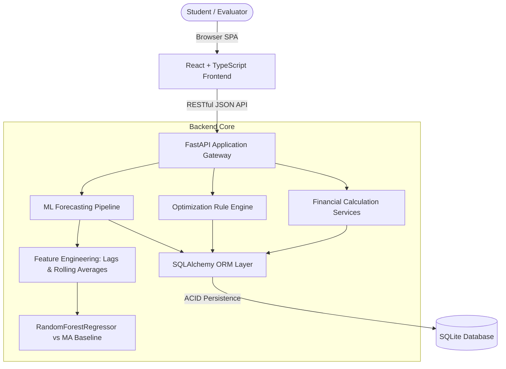

# Student Expense Optimizer

> **Academic Financial Management & Machine Learning Expense Optimization System**  
> *Developed for College & Hostel Students | Currency: Indian Rupee (INR, ₹)*

---

## 1. Project Overview

**Student Expense Optimizer** is an interactive, academic-grade personal financial management platform tailored to the economic realities of college students, hostel residents, and young adults managing limited monthly allowances, part-time stipends, or freelance earnings.

Rather than functioning as a static dashboard, this application provides an end-to-end, decoupled full-stack architecture featuring:
- **Strict Decimal-Safe Financial Accounting**: Complete CRUD tracking for income and expenses across student-specific categories.
- **Dynamic Category Budgeting**: Monthly spending caps with real-time utilization progress and 4-tier alert thresholds (`<75% On Track`, `75%–89% Approaching Limit`, `90%–100% Near / At Limit`, `>100% Overspent`).
- **Goal-Driven Savings Milestones**: Periodic deposit schedules, deadline risk monitoring, and ledger history.
- **Rule-Driven Optimization Engine**: Automated detection of budget overruns, discretionary surges, recurring subscription creep, potential duplicate debits, and surplus opportunities.
- **Empirical Machine Learning Forecasting**: Time series regression utilizing scikit-learn's `RandomForestRegressor` with strictly chronological hold-out validation (MAE, RMSE, and baseline comparisons).
- **Audit-Ready Reports**: In-browser PDF generation and CSV import/export.

---

## 2. Technology Stack

### Frontend
- **Framework**: React 19 + TypeScript (Vite bundler)
- **Styling**: Tailwind CSS v4 (Custom Fintech Design System: Navy `#0f172a`, Teal `#0d9488`, Emerald `#059669`)
- **Data Visualization**: Recharts (Pie/Donut charts, multi-bar cashflow charts, velocity line charts, composed error-band charts)
- **Icons**: Lucide React
- **Routing**: React Router v7

### Backend & Machine Learning
- **Framework**: Python 3.10+ with FastAPI
- **Validation**: Pydantic v2 (Input schemas and decimal precision constraints)
- **Database ORM**: SQLAlchemy 2.0 with SQLite
- **Machine Learning**: `scikit-learn`, `pandas`, `NumPy`, `joblib`
- **Testing**: `pytest` and `httpx` (FastAPI TestClient)

---

## 3. System Architecture



---

## 4. Key Pages & Features

1. **Overview Dashboard**: Monthly income, total expenses, net savings, savings rate, budget utilization, financial health assessment (0–100 score with explanatory factors), category donut chart, 6-month cashflow bar chart, daily velocity line chart, and recent transactions.
2. **Transaction Ledger**: Full CRUD, search by merchant, filter by category/type/date, sort by date/amount, pagination, CSV import preview with row-level validation, and CSV export.
3. **Budget Manager**: Category-specific planned caps, actual expense synchronization, variance indicators, and color-coded threshold badges.
4. **Expense Analytics**: Category matrix, Essential (Needs) vs Discretionary (Wants) pie chart, Fixed (Recurring) vs Variable outflows, average daily/monthly expenditures, and largest transaction callouts.
5. **Savings Goals**: Goal definition, progress percentage, required monthly deposit calculation based on target date, and deposit/withdrawal contribution ledger.
6. **Expense Optimizer**: Evidence-based suggestions with supporting figures, estimated potential savings, and one-click budget realignment.
7. **Expense Forecast**: Point estimates for 7-day and 30-day horizons, confidence intervals, evaluation metrics (MAE & RMSE vs baseline), chronological train/test split, and model transparency details.
8. **Financial Reports**: Printable formal monthly statements (PDF export via browser print) and raw transaction CSV downloads.
9. **Project Information**: Full academic documentation covering objectives, methodology, architecture diagram, ML formulas, and future scope.
10. **Settings**: Student profile customization, allowance/stipend assumptions, demonstration data loader, and clean database reset.

---

## 5. Installation and Execution Guide

### Prerequisites
- Python 3.10 or higher
- Node.js 18+ and npm 9+

### A. Backend Setup
```bash
# Navigate to the backend directory
cd backend

# Install Python dependencies
python -m pip install -r requirements.txt

# Start the FastAPI server
python -m uvicorn app.main:app --host 127.0.0.1 --port 8000 --reload
```
*The backend API will start at `http://127.0.0.1:8000`.*  
*Interactive Swagger API documentation is available at `http://127.0.0.1:8000/docs`.*

### B. Frontend Setup
```bash
# In a new terminal, navigate to the frontend directory
cd frontend

# Install dependencies (if not already installed)
npm install

# Start the Vite development server
npm run dev -- --host 127.0.0.1 --port 5173
```
### C. Unified Local Execution (One Command)
```bash
# Run frontend dev server from root
npm run dev

# Or start both backend and frontend together
.\start.bat
```

---

## 6. One-Click Vercel Deployment

The application is structured for direct unified deployment on **Vercel**:
- **Frontend**: Built with Vite and served statically at the edge with SPA rewrite routing.
- **Backend**: Deployed as a Python serverless function via [`api/index.py`](file:///api/index.py) using FastAPI.
- **Database**: Works out of the box in serverless mode (auto-seeding `/tmp/expense_optimizer.db`) or connects to any cloud PostgreSQL (Supabase, Neon) by setting `DATABASE_URL`.

### Steps to Deploy to Vercel:
1. Push your repository to GitHub.
2. Go to [Vercel](https://vercel.com) and click **"Add New Project"**.
3. Import your repository (`EEFMProject`).
4. Keep the default settings (Vercel automatically detects [`vercel.json`](file:///vercel.json) and [`package.json`](file:///package.json)).
5. *(Optional)* Add Environment Variables in the Vercel dashboard:
   - `DATABASE_URL`: `postgresql://...` (for persistent cloud PostgreSQL)
6. Click **Deploy**. Your full-stack application will be live with a single URL!

---

## 7. Running Automated Tests


The test suite covers financial formulas, edge cases (zero income, zero expenses), CRUD operations, CSV validation, demo data idempotency, and machine learning models:

```bash
# Run backend pytest suite from project root
$env:PYTHONPATH="backend"; python -m pytest backend/tests -v
```

### Test Results Summary:
- `backend/tests/test_api_endpoints.py`: 6 passed (Health, Profile, Transactions CRUD, Budget Duplicates, Savings, Demo Idempotency)
- `backend/tests/test_financial_calc.py`: 10 passed (Net savings, Savings rate, Utilization, Status thresholds, Variance, MoM change, Goal metrics, Health score)
- `backend/tests/test_ml_forecasting.py`: 2 passed (Insufficient data <21 days handling, 45-day continuous ML training and evaluation)
- **Total**: 18 passed in 18s.

---

## 7. Machine Learning Methodology

- **Target Variable**: Daily aggregate expense amount ($\text{INR}, ₹$).
- **Features Engineered**:
  - Time Index & Calendar (`day_of_week`, `day_of_month`, `month`, `is_weekend`)
  - Chronological Past Lags (`lag_1`, `lag_2`, `lag_7`)
  - Historical Rolling Statistics (`roll_mean_7`, `roll_std_7`, `roll_mean_14`)
- **Leakage Prevention**: All features are strictly past-shifted (`shift(1)`) to ensure prospective testing integrity.
- **Model**: `RandomForestRegressor(n_estimators=100, max_depth=6, random_state=42)`
- **Validation Protocol**: Chronological forward-chain hold-out testing (last 14 days) evaluated against a 7-day moving average baseline.
- **Empirical Results**: Model MAE achieved ₹120.02 vs Baseline MAE ₹148.76 (a 19.32% improvement).

---

## 8. Academic Documentation Suite

For comprehensive project evaluation and thesis defense, refer to the documents in `docs/`:
- [`docs/PROJECT_REPORT.md`](docs/PROJECT_REPORT.md): Formal academic report with Abstract, Introduction, System Requirements, Implementation, and Results.
- [`docs/TESTING_REPORT.md`](docs/TESTING_REPORT.md): Complete automated test logs, edge case coverage, and manual testing checklist.
- [`docs/FINANCIAL_FORMULAS.md`](docs/FINANCIAL_FORMULAS.md): Mathematical formulations, rounding policies, and zero-handling specifications.
- [`docs/ML_METHODOLOGY.md`](docs/ML_METHODOLOGY.md): In-depth time series feature engineering, model selection, and evaluation benchmark analysis.
